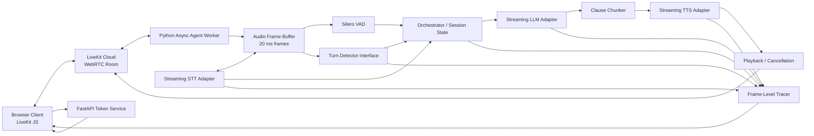
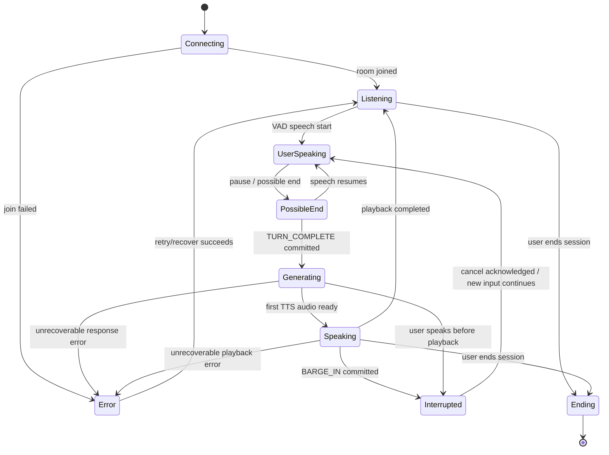

# System Architecture

## 1. Purpose

This document describes how the **Speaker-Invariant Turn Detection System for Real-Time Voice-to-Voice Conversation Using Anti-Transfer Learning** fits into the existing low-latency voice-to-voice agent. The turn detector is a new decision component; it should not force a rewrite of the existing STT, LLM, TTS, WebRTC, or tracing layers.

## 2. Architecture principles

1. **Streaming-first:** consume frames continuously and make incremental decisions.
2. **Separate speech from turn state:** VAD answers “is speech present?”; turn detection answers “should the floor remain with the user, be released, or should the agent stop speaking?”
3. **Vendor isolation:** adapters provide consistent interfaces so hosted providers can be replaced with local fallbacks.
4. **One source of session truth:** the orchestrator owns the current conversation state and active response/cancellation identifiers.
5. **Observable by default:** event timestamps and state transitions are traced end-to-end.
6. **Research isolation:** baseline and anti-transfer model variants use the same input contract and decision-policy interface.

## 3. High-level components



The diagram is logical, not a statement that every service must run in a separate process. The first implementation may host VAD, detector, orchestration, and tracing inside the Python worker.

## 4. Components and responsibilities

### 4.1 Browser client

- Request microphone access and show explicit microphone/session state.
- Join/leave the LiveKit room using a server-issued short-lived token.
- Publish microphone audio and play the agent's audio stream.
- Cancel or flush queued playback when a cancellation event arrives.
- Receive structured state/trace updates for the frontend console.
- Never contain Deepgram, Groq, or other server provider secrets.

### 4.2 FastAPI token service

- Validate session creation requests.
- Issue short-lived LiveKit room tokens with least-privilege room grants.
- Apply CORS and basic request validation.
- Avoid returning provider secrets or unnecessary personal/session data.
- Expose service health and a version/build identifier if useful for reproducibility.

### 4.3 LiveKit Cloud / WebRTC

- Transport live audio and agent audio to/from the browser.
- Carry the active session in a room.
- Surface connection/reconnection status so transport failures can be distinguished from detector errors.

### 4.4 Python asyncio agent worker / orchestrator

The orchestrator is the control centre and the single owner of session state. It:

- consumes timestamped frames and STT events;
- holds the active detector mode and threshold configuration;
- tracks whether the session is listening, waiting for turn completion, generating, speaking, or recovering from interruption;
- decides when to start/cancel LLM and TTS work;
- handles speculative prefill, clause chunking, barge-in, and conversation-history truncation;
- correlates asynchronous events using a session ID and response generation ID;
- writes trace events and trial summaries.

The orchestrator should not embed model-specific inference logic.

### 4.5 Audio frame buffer

- Normalise incoming audio to the model-required sample rate/channel format.
- Preserve monotonic timestamps and sequence numbers.
- Start with the 20 ms frame size in the existing design; model-specific feature windows may aggregate frames.
- Detect missing frames and record the gap rather than silently fabricating timestamps.
- Keep buffers bounded to prevent growing latency under load.

### 4.6 Voice activity detector (VAD)

Silero VAD remains the low-cost speech-presence signal. It may gate which frames are sent to some detector stages, but it must not by itself determine the semantic completion of a conversational turn. A VAD transition from speech to silence is evidence, not proof, that the speaker has finished.

### 4.7 Turn detector interface

Provide one adapter contract with at least two modes:

- `silence_baseline`: VAD plus configurable silence duration and any simple stability guards.
- `anti_transfer`: model trained/adapted with an anti-transfer objective aimed at reducing speaker-identity influence on turn-state prediction.

Optional additional mode:

- `learned_control`: learned turn detector without the anti-transfer objective, enabling an ablation study if compute/data permits.

The interface must keep the rest of the system agnostic to whether the selected implementation is a threshold rule, a local model, or a hosted model.

### 4.8 STT adapter

Baseline plan from the project presentation:

- Primary: Deepgram Nova-3 over streaming WebSocket.
- Open/local fallback: faster-whisper.

The adapter emits timestamped partial and final transcript hypotheses. Partial text may help detect syntactic completion or support speculative LLM prefill, but rapidly changing partials must not trigger duplicate unbounded generations. Turn detection must continue to work if transcript text is unavailable or delayed.

### 4.9 LLM adapter

Baseline plan:

- Primary: Groq-hosted Llama 3.1 8B Instant with token streaming.
- Local fallback: an appropriate small model through Ollama.

The LLM is called when the orchestrator considers the user turn complete, or earlier for speculative prefill. Speculative work must be tied to a revision/version of the partial transcript; discard or cancel it if the source transcript changes materially.

### 4.10 Clause chunker and TTS adapter

Baseline plan:

- Primary TTS: Deepgram Aura-2 streaming WebSocket.
- Open-weight fallback: Kokoro-82M.

The LLM stream is grouped into speakable clauses/chunks. TTS output is cancellable. The system must invalidate queued audio after barge-in and avoid replaying old response chunks after a new response generation begins.

### 4.11 Frame-level tracer

Record all trace points against a monotonic clock, plus a wall-clock timestamp for exports when needed. Required trace points include:

- audio frame received;
- VAD speech start/stop;
- turn detector inference started/completed;
- turn event emitted and decision committed;
- STT partial/final received;
- LLM request started and first token received;
- TTS request started and first audio chunk received;
- first response audio delivered to playback;
- barge-in detected, cancellation requested, and cancellation acknowledged;
- provider/network errors and dropped frames.

Calculate p50, p95, and p99 by stage and for aggregate metrics. Maintain enough raw event detail to recompute aggregates later. Never mix wall-clock durations with monotonic-clock durations.

## 5. Turn detector model concept

### 5.1 Target representation

The target is a representation that preserves information useful to turn decisions—speech continuation, pause structure, prosody, phrase-final cues, and potentially transcript stability—while discouraging reliance on speaker-identity information when identity is not needed for the decision.

### 5.2 Anti-transfer learning hypothesis

A candidate implementation can compare the activations/features used by the turn detector with features from a speaker-identity encoder or speaker classifier and penalise similarity or task leakage. The exact objective, model architecture, loss weight, and teacher/encoder selection remain research decisions. The project must test the trade-off: less speaker leakage is only useful if turn-detection performance remains adequate or improves.

### 5.3 Inputs and outputs

Potential input signals:

- current audio frame or short streaming context window;
- VAD probability/state;
- recent frame history and silence duration;
- optional ASR partial/final transcript and its stability;
- current agent state (listening versus speaking).

Required logical outputs:

- `CONTINUE`: evidence suggests the user still owns the turn;
- `POSSIBLE_END`: speech paused or may be ending; continue observing/gathering evidence;
- `TURN_COMPLETE`: commit to the user turn being complete and permit agent generation;
- `BARGE_IN`: user speech during agent output warrants cancellation/listening transition.

Optional output:

- `BACKCHANNEL`: short listener acknowledgement that should not necessarily trigger a full response.

Each inference event should include: event name, confidence/probability where available, frame/window end time, inference duration, model version, detector mode, and decision-policy version. Confidence should be omitted rather than fabricated for deterministic baselines.

### 5.4 Decision policy

The detector estimates event likelihood; the orchestrator commits state transitions using the selected policy. A simple policy may require a minimum confidence for a minimum number of consecutive frames, plus a configurable endpointing guard. Thresholds are experimental parameters and must be recorded per trial. The policy should minimise early interruptions while avoiding excessive endpoint delay.

## 6. State machine



State transitions must be driven by explicit events, not by UI guesses. The frontend may show a smoothed representation for readability, but trace events remain the source of truth.

## 7. Event and API contracts

### 7.1 Suggested turn event

```json
{
  "session_id": "session_...",
  "sequence": 42,
  "event_type": "TURN_COMPLETE",
  "detector_mode": "anti_transfer",
  "model_version": "turn-detector-0.1.0",
  "event_end_ms": 18420,
  "inference_ms": 7.4,
  "confidence": 0.87,
  "decision_policy_version": "policy-0.1",
  "reason_codes": ["stable_pause", "high_turn_end_score"]
}
```

Illustrative schema only; values are examples, not measured results. `confidence` may be nullable. `event_end_ms` should be defined relative to the session's monotonic origin so events can be aligned reliably.

### 7.2 Suggested trace event

```json
{
  "session_id": "session_...",
  "trial_id": "trial_...",
  "trace_id": "trace_...",
  "stage": "tts_first_audio",
  "timestamp_monotonic_ms": 19371.5,
  "duration_ms": 84.2,
  "detector_mode": "anti_transfer",
  "provider": "deepgram_aura_2",
  "status": "ok"
}
```

### 7.3 Frontend update channel

Use the existing LiveKit room data channel or an authenticated server-sent/WebSocket stream for structured session updates, depending on the implementation. Do not expose internal credentials. The event contract must support:

- session connection/status;
- turn-state change;
- partial/final transcript when enabled;
- stage latency update;
- trial completion/summary;
- recoverable error.

## 8. Data model

Recommended entities:

- **Session:** ID, start/end timestamps, client build, language/config flags, connection outcome.
- **Trial:** session ID, trial ID, scenario ID, detector mode, model version, threshold/policy configuration, speaker split tag (non-identifying pseudonymous label), environment and provider metadata.
- **Turn event:** timestamp, predicted event, optional confidence, committed state transition.
- **Trace span:** stage, start/end, duration, status, optional provider metadata.
- **Annotation:** ground-truth turn start/end, optional overlap/backchannel labels, annotator/schema version.
- **Trial summary:** endpoint delay, response-start latency, false-end/missed-end and interruption metrics.

Avoid names, account identifiers, or other personal fields unless genuinely necessary. Pseudonymous speaker IDs for research splits should not be traceable to real identities.

## 9. Error handling and cancellation

- All asynchronous generation and TTS tasks should be associated with a response generation ID.
- On barge-in, mark the current generation cancelled, cancel its LLM/TTS tasks when supported, flush playback buffers, and reject any late chunks associated with the cancelled ID.
- Preserve the user's new utterance in history, but avoid retaining obsolete speculative assistant output as if it had been delivered.
- On network failure, preserve state needed to show a recoverable error and do not convert the error into a `TURN_COMPLETE` event.
- Timeouts should be bounded; the session must return to a usable state after an adapter failure or be explicitly closed.

## 10. Security and privacy controls

- Provider credentials are environment/secrets-manager values on the worker only.
- Room token generation must validate the request and use short-lived grants.
- Raw audio is not persisted by default.
- Transcript display and transcript export should be independently configurable.
- Trial exports should identify whether transcripts were included and what retention policy applied.
- Logs should avoid secrets, full tokens, and unnecessary personal content.
- Add a clear session-end path; implement deletion if persistent recording/storage is added later.

## 11. Deployment profiles

### Profile A — Hosted demo

- LiveKit Cloud transport.
- Browser frontend.
- Python agent worker.
- Hosted STT/LLM/TTS adapters within current quotas.
- Local turn-detector inference if it improves reproducibility.

### Profile B — Reproducible/local benchmark

- Local or self-hosted transport where feasible.
- faster-whisper for STT, Ollama for LLM, and Kokoro-82M for TTS as documented fallbacks.
- Fixed hardware/software versions and saved detector configs.
- Use identical labelled evaluation clips/scenarios across detector variants.

Quota/pricing information shown in the September 2026 presentation is a historical project planning assumption and must be rechecked before use.

## 12. Architecture acceptance criteria

- A baseline and anti-transfer detector can be selected without changing the event consumer.
- Every committed turn transition can be traced to input event timestamps and a configuration/model version.
- An interruption cancels old playback and stale chunks cannot leak into the next response.
- Stage and end-to-end latency summaries can be recomputed from stored trace events.
- Provider outage is distinguishable from a detector error.
- No raw audio is stored unless a deliberate opt-in recording feature is implemented.
